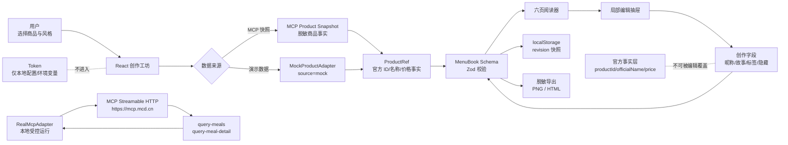

# My McMenu Architecture

## 层次说明

| 层 | 职责 | 安全边界 |
|---|---|---|
| MCP Client | 初始化 MCP、调用只读工具、处理超时和 HTTP 错误 | Token 只在本地/受控运行时 |
| RealMcpAdapter | 把官方返回映射为 `ProductRef` | 不生成商品 ID，不猜字段 |
| MockProductAdapter | 无 Token 时提供可运行演示数据 | `source=mock`，不得伪装真实 MCP |
| Domain / Schema | 校验 `MenuBook` 六页、引用和版本 | 官方字段与创作字段分离 |
| React UI | 创作工坊、阅读器、编辑抽屉和来源标识 | 浏览器不持有 MCP Token |
| Storage | 保存经过 Schema 校验的本地草稿 | 不保存 MCP 配置、地址或订单 |
| Export | 生成当前页 PNG 和整本 HTML | 导出模型剔除图片 URL、Token、门店上下文和订单 |
